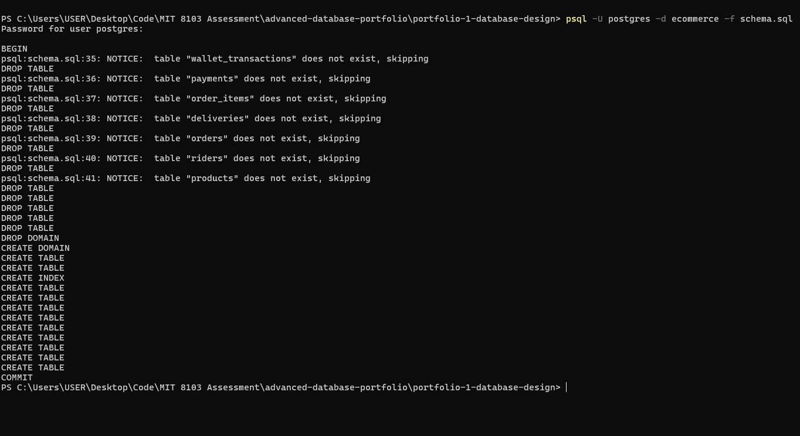
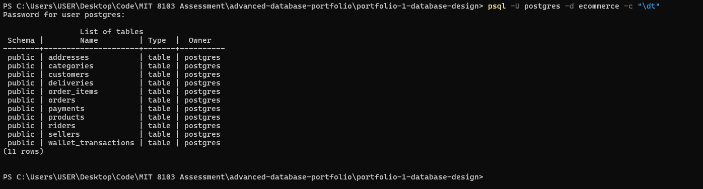
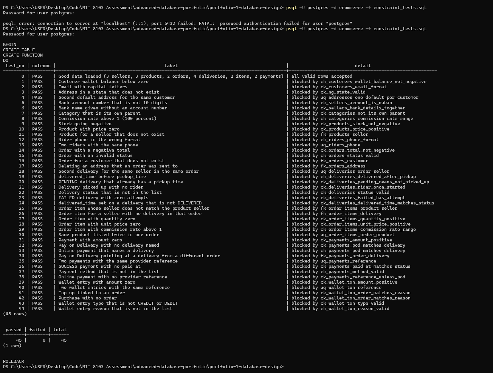
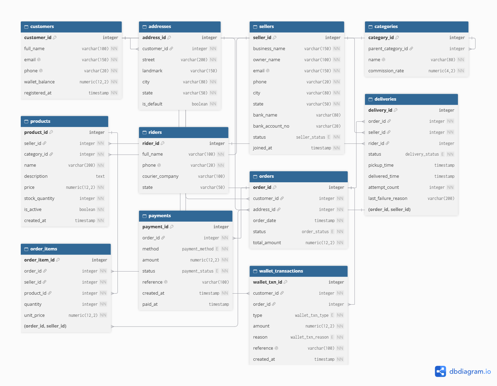

# Portfolio 1: Database Design and Modelling

**Course:** MIT 8103 Advanced Database Systems (Miva Open University)
**Case study:** NaijaMart, a simulated Nigerian online marketplace where independent sellers list products and customers buy them
**Database:** PostgreSQL, database name `ecommerce`, 11 tables

This folder holds everything for Portfolio 1: the case study, the ER diagram, the relational schema with its keys and constraints, a test script that tries to break those constraints, and the normalization write-up.

Part of this folder was generated with an AI tool (Claude) and then run and checked by me. The full declaration is in [`../AI-USE.md`](../AI-USE.md).

---

## 1. File index

| File                                                  | What it is                                                                                                             |
| ----------------------------------------------------- | ---------------------------------------------------------------------------------------------------------------------- |
| [`case-study.md`](case-study.md)                     | The NaijaMart case study: the organisation, its users, the data, the operations and the problems each portfolio solves |
| [`erd.png`](erd.png)                                 | ER diagram of the 11 tables, exported from dbdiagram.io                                                                |
| [`schema.sql`](schema.sql)                           | Creates all 11 tables with primary keys, foreign keys, composite foreign keys, unique rules and CHECK constraints      |
| [`constraint_tests.sql`](constraint_tests.sql)       | Loads good sample rows, then runs 44 bad statements, one per rule, and reports PASS or FAIL for each                   |
| [`normalization.md`](normalization.md)               | Walkthrough from one flat sheet to 3NF, a check of every table, and the deliberate exceptions with the reason for each |
| [`p1-schema-run.png`](p1-schema-run.png)             | Screenshot: `schema.sql` running and ending with `COMMIT`                                                          |
| [`p1-tables.png`](p1-tables.png)                     | Screenshot: `\dt` listing all 11 tables                                                                              |
| [`p1-constraint-tests.png`](p1-constraint-tests.png) | Screenshot: the constraint tests, 45 of 45 passed                                                                      |

---

## 2. How to run each script

**What you need:** PostgreSQL with the `psql` command line tool. The commands below are for PowerShell or any terminal, run from this folder. `psql` asks for the `postgres` password each time.

**Step 0: create the database once**

```
psql -U postgres -c "CREATE DATABASE ecommerce;"
```

**Step 1: create the schema**

```
psql -U postgres -d ecommerce -f schema.sql
```

The script runs inside one transaction and ends with `COMMIT`. It starts by dropping any existing NaijaMart tables, so running it again resets the database to empty tables. Do not run it on a database that holds data you want to keep.

**Step 2: check that all 11 tables exist**

```
psql -U postgres -d ecommerce -c "\dt"
```

Expected: 11 rows.

**Step 3: run the constraint tests**

```
psql -U postgres -d ecommerce -f constraint_tests.sql
```

What it does:

1. Inserts a small set of valid rows (3 sellers, 3 products, 2 orders, 4 deliveries, 2 order items, 2 payments). This proves valid data is accepted.
2. Tries 44 invalid statements. Each one must be rejected by the specific constraint named in the test, not just by any error.
3. Prints a result table, then a count of passed and failed tests.
4. Ends with `ROLLBACK`, so no test data stays in the database.

Expected: `passed 45, failed 0, total 45`. The 45 is the 44 bad statements plus one row for the good-data load.

---

## 3. Evidence

### Schema creation

All tables created in one transaction, ending with `COMMIT`. The "does not exist, skipping" notices appear because this was the first run on an empty database.



### All 11 tables



### Constraint tests

Every bad statement was blocked by the constraint it was designed to hit. The two most important ones are test 25 (an order item whose seller does not match the product's seller, blocked by `fk_order_items_product_seller`) and test 9 (stock going negative, blocked by `ck_products_stock_not_negative`).



### ER diagram



The diagram cannot draw CHECK constraints, so those are only in `schema.sql` and are covered by the tests. The composite keys appear as the bracketed pairs at the bottom of `products`, `deliveries`, `order_items` and `payments`.

---

## 4. Key design choices and what I would do differently

**Key design choices.** Each product belongs to exactly one seller, and composite foreign keys make the database itself reject an order item whose seller disagrees with its product or its delivery, so that rule does not depend on application code. A few values are kept on purpose even though normalization says to avoid them: `unit_price` and `commission_rate` on `order_items` are frozen snapshots so old orders never change, while `total_amount` and `wallet_balance` are derived values kept for speed, with the wallet history stored as a ledger. I used `CHECK` constraints instead of enum types because the status lists may grow and a CHECK is easy to change, and I left out speed indexes on purpose so the before and after query plans in Portfolio 2 are a fair comparison.

**What I would do differently.** I would close a gap I found late: an order can currently point at an address that belongs to another customer, which needs one more composite key on `addresses`. I would also protect `total_amount` and `wallet_balance` inside the database, for example with a trigger, because right now they stay correct only through transaction code and an audit query. Finally, I would write the constraint tests alongside each table instead of after the whole schema, so every rule is proven as soon as it is added.

Full detail on the normalization reasoning is in [`normalization.md`](normalization.md).
