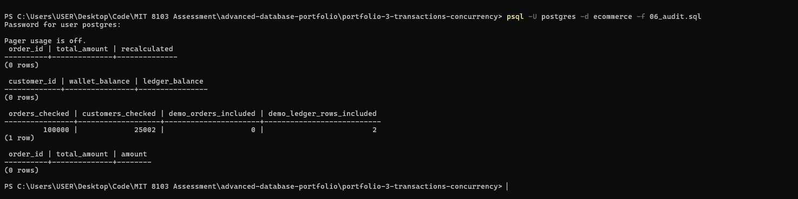

# Portfolio 3: Transactions and Concurrency

This portfolio shows what happens when the NaijaMart database does several things at once. Each demo has two parts: a **before** (the problem, or the state before the change) and an **after** (the fix, or the result). Most demos use **two psql windows** side by side, so you can see two people using the shop at the same moment.

## Words used in these demos

| Word                      | Plain meaning                                                                                 |
| ------------------------- | --------------------------------------------------------------------------------------------- |
| **Transaction**     | A group of changes that succeed or fail **together**. It starts with `BEGIN`.         |
| **COMMIT**          | "Save it all, and let everyone see it."                                                       |
| **ROLLBACK**        | "Undo everything since `BEGIN`."                                                            |
| **SAVEPOINT**       | A bookmark inside a transaction. `ROLLBACK TO` the bookmark undoes only the work after it.  |
| **Lock**            | While you change a row, others who want the same row must wait.                               |
| **Deadlock**        | Two people each hold a lock the other needs, so both wait forever. PostgreSQL breaks the tie. |
| **Isolation level** | A rule for what a transaction may see while others are changing data.                         |
| **Error 40001**     | "This clashed with another transaction. Nothing was saved. Try again."                        |
| **Error 40P01**     | "Deadlock detected." One transaction was cancelled.                                           |

## The demos

| Script                        | What it shows                                                                | Windows | Before to after                                                                                 |
| ----------------------------- | ---------------------------------------------------------------------------- | ------- | ----------------------------------------------------------------------------------------------- |
| `01_commit.sql`             | Placing an order (order, delivery, items, stock, payment) as one transaction | 2       | Window 2 sees **nothing** before `COMMIT`, **everything** after                   |
| `02_rollback_savepoint.sql` | One item runs out of stock: `ROLLBACK`, then `SAVEPOINT`                 | 1       | Whole order undone, then only the failed item undone                                            |
| `03_oversell.sql`           | The last item sold twice, then three fixes                                   | 2       | OVERSOLD, then fixed with `FOR UPDATE`, an atomic `UPDATE`, and `SERIALIZABLE` plus retry |
| `04_isolation_levels.sql`   | Non-repeatable read, snapshot, write skew                                    | 2       | `READ COMMITTED`, then `REPEATABLE READ`, then `SERIALIZABLE`                             |
| `05_deadlock.sql`           | Two wallet jobs in opposite order, then in the same order                    | 2       | Error 40P01, then no error                                                                      |
| `06_audit.sql`              | The two audit queries from Portfolio 1                                       | 1       | 0 rows before the demos, 0 rows after                                                           |

**Evidence note:** I ran all six demos myself, but I only kept screenshots for the setup, demos 1 and 2 and the closing audit (see *Screenshots* below). Screenshots for demos 3 to 5 were not captured. The scripts and the results I saw are in this folder and described below.

Support files: `00_demo_setup.sql`, `demo_window.sql` (sets up each window), `99_cleanup.sql` (removes the demo data) and `screenshots/`.

The demos use their own **demo customers and demo products** (all named "demo"/"DEMO"). Your real NaijaMart data is not changed, and `99_cleanup.sql` removes everything the demos add.

## Setup (once)

You need psql version 13 or newer. Open PowerShell in this folder.

```
psql -U postgres -d ecommerce -f 00_demo_setup.sql
psql -U postgres -d ecommerce -f 06_audit.sql
```

The second command is the **baseline audit**: both audit queries should show `(0 rows)` before anything has happened.

## How to run a demo

1. Open **two** PowerShell windows in this folder. Start psql in each:

   ```
   psql -U postgres -d ecommerce -v win=1
   psql -U postgres -d ecommerce -v win=2
   ```
2. In **both** windows type `\i demo_window.sql`. The prompt now shows the window and the transaction state:

   | Prompt              | Meaning                                                            |
   | ------------------- | ------------------------------------------------------------------ |
   | `W1 ecommerce=#`  | Window 1, no transaction open                                      |
   | `W1 ecommerce=*#` | Window 1, **inside** a transaction (after `BEGIN`)         |
   | `W1 ecommerce=!#` | Window 1, the transaction **failed** and must be rolled back |

## What each demo showed

### Demo 1: COMMIT

Window 1 builds the whole order but has not committed. Window 2 sees 0 orders, 0 payments and unchanged stock (10 and 2). After `COMMIT`, window 2 sees the order (total 13,000), the payment, and stock 8 and 1, all at once.

### Demo 2: ROLLBACK and SAVEPOINT

Shopper 1 orders 1 phone case and 5 chargers, but only 2 chargers exist. Taking 5 fails with `ERROR 23514` (`ck_products_stock_not_negative`) and the transaction is marked failed (`!`). After `ROLLBACK` there are 0 orders, 0 items, and stock is back at 10 and 2. Even the phone case that worked was undone. With a `SAVEPOINT` after the first item, `ROLLBACK TO SAVEPOINT` throws away only the charger, and the order commits with just the phone case (total 3,500, phone case stock 9, charger stock still 2).

### Demo 3: the last-item oversell

This is the known gap from Portfolio 1 ("nothing stops two customers buying the last item").

**The bug (READ COMMITTED, read then write).** Both windows read stock = 1, both think it is safe, and both write `stock = 0`. There is **no error**, because 0 is a valid stock. The result is `units_sold = 2` with only 1 in stock: **OVERSOLD**.

**Three fixes, compared:**

| Fix                                                 | What shopper 2 experiences                                                                 | Result | Good                                                                               | Watch out for                                                                                                 |
| --------------------------------------------------- | ------------------------------------------------------------------------------------------ | ------ | ---------------------------------------------------------------------------------- | ------------------------------------------------------------------------------------------------------------- |
| `SELECT ... FOR UPDATE`                           | Waits until shopper 1 commits, then reads stock 0 and is told "sold out"                   | 1 sold | Easy to understand; works when you must read, then decide, over several statements | The lock is held while the app thinks, so others queue. Locking several rows in different orders can deadlock |
| One atomic `UPDATE ... WHERE stock_quantity >= 1` | Waits briefly, then the update changes **0 rows**, which means "sold out"            | 1 sold | Shortest and fastest: check and take in a single statement, no retry code          | Only works when the rule fits in one statement                                                                |
| `SERIALIZABLE` plus retry                         | No waiting. Gets error **40001**, retries, then reads stock 0 and is told "sold out" | 1 sold | Works for any rule, even if the app code is naive                                  | The app **must** catch 40001 and retry. Busy periods mean more retries                                  |

For NaijaMart's stock I would use the **atomic `UPDATE`**: it is the simplest and cheapest, and the stock rule is a single condition. `FOR UPDATE` is for decisions that need several statements, and `SERIALIZABLE` is for rules that span many rows (like demo 4's promo rule).

### Demo 4: isolation levels

- **READ COMMITTED.** Window 1 reads the price (1000.00). Window 2 changes it to 1200 and commits. Window 1 reads again and gets **1200.00**. The same query gave two answers in one transaction: a **non-repeatable read**.
- **REPEATABLE READ.** The same sequence, but window 1 keeps seeing **1000.00** until it commits (a frozen snapshot), then sees 1200.00.
- **Write skew.** The rule is "at least one promo product must stay active". Two staff members each check (2 active), then each deactivate a **different** promo. Under `REPEATABLE READ` both succeed and **0 promos are active**: the rule is broken, even though each person checked correctly.
- **SERIALIZABLE.** The same sequence: staff 1 commits, and staff 2 gets **error 40001**. On retry the check sees only 1 active promo, so the app refuses to deactivate the last one.

### Demo 5: deadlock

Two bonus jobs each add 500 naira to both shoppers' wallets (balance update plus ledger row, in one transaction). Job 1 goes Shopper 1 then Shopper 2, and Job 2 goes Shopper 2 then Shopper 1. Each ends up waiting for a row the other holds. After about 1 second PostgreSQL cancels one of them with **error 40P01 "deadlock detected"** (the DETAIL lines say who waited for whom). The cancelled job is rolled back and retried, and both wallets end at 6,000.

**The fix:** both jobs credit the **smallest customer id first**. The second job simply waits in line. No circle, no error, no retry, same final result.

### Demo 6: the closing audit

After all the demos, both audit queries from Portfolio 1 (`normalization.md`) still return **0 rows**: every order's `total_amount` equals the sum of its items, and every `wallet_balance` equals its ledger. The audits covered all 100,001 orders and 25,002 customers, including the demo order and the demo wallet rows. A bonus check also confirms the demo payment equals its order total.

## Screenshots

| Screenshot                                                                | Shows                                                                       |
| ------------------------------------------------------------------------- | --------------------------------------------------------------------------- |
|                                | `00_demo_setup.sql` creating the demo data                                |
|              | Demo 1: the order built inside a transaction, before `COMMIT`             |
|                | Demo 2: after the failed update, commands are ignored until `ROLLBACK`    |
|          | Demo 2: after `ROLLBACK`, 0 orders and stock back to 10 and 2             |
|  | Demo 2: error 23514, then `ROLLBACK TO SAVEPOINT` keeps the first item    |
|      | Demo 2: the order committed with the phone case only (total 3,500, stock 9) |
|                                         | `06_audit.sql`: both audit queries return 0 rows                          |

## Cleanup

```
psql -U postgres -d ecommerce -f 99_cleanup.sql
psql -U postgres -d ecommerce -f 06_audit.sql
```

The second command should still show `(0 rows)` twic

# Portfolio 3: Transactions and Concurrency

This portfolio shows what happens when the NaijaMart database does several things at once. Each demo has two parts: a **before** (the problem, or the state before the change) and an **after** (the fix, or the result). Most demos use **two psql windows** side by side, so you can see two people using the shop at the same moment.

## Words used in these demos

| Word                      | Plain meaning                                                                                 |
| ------------------------- | --------------------------------------------------------------------------------------------- |
| **Transaction**     | A group of changes that succeed or fail **together**. It starts with `BEGIN`.         |
| **COMMIT**          | "Save it all, and let everyone see it."                                                       |
| **ROLLBACK**        | "Undo everything since `BEGIN`."                                                            |
| **SAVEPOINT**       | A bookmark inside a transaction. `ROLLBACK TO` the bookmark undoes only the work after it.  |
| **Lock**            | While you change a row, others who want the same row must wait.                               |
| **Deadlock**        | Two people each hold a lock the other needs, so both wait forever. PostgreSQL breaks the tie. |
| **Isolation level** | A rule for what a transaction may see while others are changing data.                         |
| **Error 40001**     | "This clashed with another transaction. Nothing was saved. Try again."                        |
| **Error 40P01**     | "Deadlock detected." One transaction was cancelled.                                           |

## The demos

| Script                        | What it shows                                                                | Windows | Before to after                                                                                 |
| ----------------------------- | ---------------------------------------------------------------------------- | ------- | ----------------------------------------------------------------------------------------------- |
| `01_commit.sql`             | Placing an order (order, delivery, items, stock, payment) as one transaction | 2       | Window 2 sees **nothing** before `COMMIT`, **everything** after                   |
| `02_rollback_savepoint.sql` | One item runs out of stock: `ROLLBACK`, then `SAVEPOINT`                 | 1       | Whole order undone, then only the failed item undone                                            |
| `03_oversell.sql`           | The last item sold twice, then three fixes                                   | 2       | OVERSOLD, then fixed with `FOR UPDATE`, an atomic `UPDATE`, and `SERIALIZABLE` plus retry |
| `04_isolation_levels.sql`   | Non-repeatable read, snapshot, write skew                                    | 2       | `READ COMMITTED`, then `REPEATABLE READ`, then `SERIALIZABLE`                             |
| `05_deadlock.sql`           | Two wallet jobs in opposite order, then in the same order                    | 2       | Error 40P01, then no error                                                                      |
| `06_audit.sql`              | The two audit queries from Portfolio 1                                       | 1       | 0 rows before the demos, 0 rows after                                                           |

**Evidence note:** I ran all six demos myself, but I only kept screenshots for the setup, demos 1 and 2 and the closing audit (see *Screenshots* below). Screenshots for demos 3 to 5 were not captured. The scripts and the results I saw are in this folder and described below.

Support files: `00_demo_setup.sql`, `demo_window.sql` (sets up each window), `99_cleanup.sql` (removes the demo data) and `screenshots/`.

The demos use their own **demo customers and demo products** (all named "demo"/"DEMO"). Your real NaijaMart data is not changed, and `99_cleanup.sql` removes everything the demos add.

## Setup (once)

You need psql version 13 or newer. Open PowerShell in this folder.

```
psql -U postgres -d ecommerce -f 00_demo_setup.sql
psql -U postgres -d ecommerce -f 06_audit.sql
```

The second command is the **baseline audit**: both audit queries should show `(0 rows)` before anything has happened.

## How to run a demo

1. Open **two** PowerShell windows in this folder. Start psql in each:

   ```
   psql -U postgres -d ecommerce -v win=1
   psql -U postgres -d ecommerce -v win=2
   ```
2. In **both** windows type `\i demo_window.sql`. The prompt now shows the window and the transaction state:

   | Prompt              | Meaning                                                            |
   | ------------------- | ------------------------------------------------------------------ |
   | `W1 ecommerce=#`  | Window 1, no transaction open                                      |
   | `W1 ecommerce=*#` | Window 1, **inside** a transaction (after `BEGIN`)         |
   | `W1 ecommerce=!#` | Window 1, the transaction **failed** and must be rolled back |

## What each demo showed

### Demo 1: COMMIT

Window 1 builds the whole order but has not committed. Window 2 sees 0 orders, 0 payments and unchanged stock (10 and 2). After `COMMIT`, window 2 sees the order (total 13,000), the payment, and stock 8 and 1, all at once.

### Demo 2: ROLLBACK and SAVEPOINT

Shopper 1 orders 1 phone case and 5 chargers, but only 2 chargers exist. Taking 5 fails with `ERROR 23514` (`ck_products_stock_not_negative`) and the transaction is marked failed (`!`). After `ROLLBACK` there are 0 orders, 0 items, and stock is back at 10 and 2. Even the phone case that worked was undone. With a `SAVEPOINT` after the first item, `ROLLBACK TO SAVEPOINT` throws away only the charger, and the order commits with just the phone case (total 3,500, phone case stock 9, charger stock still 2).

### Demo 3: the last-item oversell

This is the known gap from Portfolio 1 ("nothing stops two customers buying the last item").

**The bug (READ COMMITTED, read then write).** Both windows read stock = 1, both think it is safe, and both write `stock = 0`. There is **no error**, because 0 is a valid stock. The result is `units_sold = 2` with only 1 in stock: **OVERSOLD**.

**Three fixes, compared:**

| Fix                                                 | What shopper 2 experiences                                                                 | Result | Good                                                                               | Watch out for                                                                                                 |
| --------------------------------------------------- | ------------------------------------------------------------------------------------------ | ------ | ---------------------------------------------------------------------------------- | ------------------------------------------------------------------------------------------------------------- |
| `SELECT ... FOR UPDATE`                           | Waits until shopper 1 commits, then reads stock 0 and is told "sold out"                   | 1 sold | Easy to understand; works when you must read, then decide, over several statements | The lock is held while the app thinks, so others queue. Locking several rows in different orders can deadlock |
| One atomic `UPDATE ... WHERE stock_quantity >= 1` | Waits briefly, then the update changes **0 rows**, which means "sold out"            | 1 sold | Shortest and fastest: check and take in a single statement, no retry code          | Only works when the rule fits in one statement                                                                |
| `SERIALIZABLE` plus retry                         | No waiting. Gets error **40001**, retries, then reads stock 0 and is told "sold out" | 1 sold | Works for any rule, even if the app code is naive                                  | The app **must** catch 40001 and retry. Busy periods mean more retries                                  |

For NaijaMart's stock I would use the **atomic `UPDATE`**: it is the simplest and cheapest, and the stock rule is a single condition. `FOR UPDATE` is for decisions that need several statements, and `SERIALIZABLE` is for rules that span many rows (like demo 4's promo rule).

### Demo 4: isolation levels

- **READ COMMITTED.** Window 1 reads the price (1000.00). Window 2 changes it to 1200 and commits. Window 1 reads again and gets **1200.00**. The same query gave two answers in one transaction: a **non-repeatable read**.
- **REPEATABLE READ.** The same sequence, but window 1 keeps seeing **1000.00** until it commits (a frozen snapshot), then sees 1200.00.
- **Write skew.** The rule is "at least one promo product must stay active". Two staff members each check (2 active), then each deactivate a **different** promo. Under `REPEATABLE READ` both succeed and **0 promos are active**: the rule is broken, even though each person checked correctly.
- **SERIALIZABLE.** The same sequence: staff 1 commits, and staff 2 gets **error 40001**. On retry the check sees only 1 active promo, so the app refuses to deactivate the last one.

### Demo 5: deadlock

Two bonus jobs each add 500 naira to both shoppers' wallets (balance update plus ledger row, in one transaction). Job 1 goes Shopper 1 then Shopper 2, and Job 2 goes Shopper 2 then Shopper 1. Each ends up waiting for a row the other holds. After about 1 second PostgreSQL cancels one of them with **error 40P01 "deadlock detected"** (the DETAIL lines say who waited for whom). The cancelled job is rolled back and retried, and both wallets end at 6,000.

**The fix:** both jobs credit the **smallest customer id first**. The second job simply waits in line. No circle, no error, no retry, same final result.

### Demo 6: the closing audit

After all the demos, both audit queries from Portfolio 1 (`normalization.md`) still return **0 rows**: every order's `total_amount` equals the sum of its items, and every `wallet_balance` equals its ledger. The audits covered all 100,001 orders and 25,002 customers, including the demo order and the demo wallet rows. A bonus check also confirms the demo payment equals its order total.

## Screenshots

| Screenshot                                                                | Shows                                                                       |
| ------------------------------------------------------------------------- | --------------------------------------------------------------------------- |
|                                | `00_demo_setup.sql` creating the demo data                                |
|              | Demo 1: the order built inside a transaction, before `COMMIT`             |
|                | Demo 2: after the failed update, commands are ignored until `ROLLBACK`    |
|          | Demo 2: after `ROLLBACK`, 0 orders and stock back to 10 and 2             |
|  | Demo 2: error 23514, then `ROLLBACK TO SAVEPOINT` keeps the first item    |
|      | Demo 2: the order committed with the phone case only (total 3,500, stock 9) |
|                                         | `06_audit.sql`: both audit queries return 0 rows                          |

## Cleanup

```
psql -U postgres -d ecommerce -f 99_cleanup.sql
psql -U postgres -d ecommerce -f 06_audit.sql
```

The second command should still show `(0 rows)` twic

# Portfolio 3: Transactions and Concurrency

This portfolio shows what happens when the NaijaMart database does several things at once. Each demo has two parts: a **before** (the problem, or the state before the change) and an **after** (the fix, or the result). Most demos use **two psql windows** side by side, so you can see two people using the shop at the same moment.

## Words used in these demos

| Word                      | Plain meaning                                                                                 |
| ------------------------- | --------------------------------------------------------------------------------------------- |
| **Transaction**     | A group of changes that succeed or fail **together**. It starts with `BEGIN`.         |
| **COMMIT**          | "Save it all, and let everyone see it."                                                       |
| **ROLLBACK**        | "Undo everything since `BEGIN`."                                                            |
| **SAVEPOINT**       | A bookmark inside a transaction. `ROLLBACK TO` the bookmark undoes only the work after it.  |
| **Lock**            | While you change a row, others who want the same row must wait.                               |
| **Deadlock**        | Two people each hold a lock the other needs, so both wait forever. PostgreSQL breaks the tie. |
| **Isolation level** | A rule for what a transaction may see while others are changing data.                         |
| **Error 40001**     | "This clashed with another transaction. Nothing was saved. Try again."                        |
| **Error 40P01**     | "Deadlock detected." One transaction was cancelled.                                           |

## The demos

| Script                        | What it shows                                                                | Windows | Before to after                                                                                 |
| ----------------------------- | ---------------------------------------------------------------------------- | ------- | ----------------------------------------------------------------------------------------------- |
| `01_commit.sql`             | Placing an order (order, delivery, items, stock, payment) as one transaction | 2       | Window 2 sees **nothing** before `COMMIT`, **everything** after                   |
| `02_rollback_savepoint.sql` | One item runs out of stock: `ROLLBACK`, then `SAVEPOINT`                 | 1       | Whole order undone, then only the failed item undone                                            |
| `03_oversell.sql`           | The last item sold twice, then three fixes                                   | 2       | OVERSOLD, then fixed with `FOR UPDATE`, an atomic `UPDATE`, and `SERIALIZABLE` plus retry |
| `04_isolation_levels.sql`   | Non-repeatable read, snapshot, write skew                                    | 2       | `READ COMMITTED`, then `REPEATABLE READ`, then `SERIALIZABLE`                             |
| `05_deadlock.sql`           | Two wallet jobs in opposite order, then in the same order                    | 2       | Error 40P01, then no error                                                                      |
| `06_audit.sql`              | The two audit queries from Portfolio 1                                       | 1       | 0 rows before the demos, 0 rows after                                                           |

Support files: `00_demo_setup.sql`, `demo_window.sql` (sets up each window), `99_cleanup.sql` (removes the demo data) and `screenshots/`.

The demos use their own **demo customers and demo products** (all named "demo"/"DEMO"). Your real NaijaMart data is not changed, and `99_cleanup.sql` removes everything the demos add.

## Setup (once)

You need psql version 13 or newer. Open PowerShell in this folder.

```
psql -U postgres -d ecommerce -f 00_demo_setup.sql
psql -U postgres -d ecommerce -f 06_audit.sql
```

The second command is the **baseline audit**: both audit queries should show `(0 rows)` before anything has happened.

## How to run a demo

1. Open **two** PowerShell windows in this folder. Start psql in each:

   ```
   psql -U postgres -d ecommerce -v win=1
   psql -U postgres -d ecommerce -v win=2
   ```
2. In **both** windows type `\i demo_window.sql`. The prompt now shows the window and the transaction state:

   | Prompt              | Meaning                                                            |
   | ------------------- | ------------------------------------------------------------------ |
   | `W1 ecommerce=#`  | Window 1, no transaction open                                      |
   | `W1 ecommerce=*#` | Window 1, **inside** a transaction (after `BEGIN`)         |
   | `W1 ecommerce=!#` | Window 1, the transaction **failed** and must be rolled back |

## What each demo showed

### Demo 1: COMMIT

Window 1 builds the whole order but has not committed. Window 2 sees 0 orders, 0 payments and unchanged stock (10 and 2). After `COMMIT`, window 2 sees the order (total 13,000), the payment, and stock 8 and 1, all at once.

### Demo 2: ROLLBACK and SAVEPOINT

Shopper 1 orders 1 phone case and 5 chargers, but only 2 chargers exist. Taking 5 fails with `ERROR 23514` (`ck_products_stock_not_negative`) and the transaction is marked failed (`!`). After `ROLLBACK` there are 0 orders, 0 items, and stock is back at 10 and 2. Even the phone case that worked was undone. With a `SAVEPOINT` after the first item, `ROLLBACK TO SAVEPOINT` throws away only the charger, and the order commits with just the phone case (total 3,500, phone case stock 9, charger stock still 2).

### Demo 3: the last-item oversell

This is the known gap from Portfolio 1 ("nothing stops two customers buying the last item").

**The bug (READ COMMITTED, read then write).** Both windows read stock = 1, both think it is safe, and both write `stock = 0`. There is **no error**, because 0 is a valid stock. The result is `units_sold = 2` with only 1 in stock: **OVERSOLD**.

**Three fixes, compared:**

| Fix                                                 | What shopper 2 experiences                                                                 | Result | Good                                                                               | Watch out for                                                                                                 |
| --------------------------------------------------- | ------------------------------------------------------------------------------------------ | ------ | ---------------------------------------------------------------------------------- | ------------------------------------------------------------------------------------------------------------- |
| `SELECT ... FOR UPDATE`                           | Waits until shopper 1 commits, then reads stock 0 and is told "sold out"                   | 1 sold | Easy to understand; works when you must read, then decide, over several statements | The lock is held while the app thinks, so others queue. Locking several rows in different orders can deadlock |
| One atomic `UPDATE ... WHERE stock_quantity >= 1` | Waits briefly, then the update changes **0 rows**, which means "sold out"            | 1 sold | Shortest and fastest: check and take in a single statement, no retry code          | Only works when the rule fits in one statement                                                                |
| `SERIALIZABLE` plus retry                         | No waiting. Gets error **40001**, retries, then reads stock 0 and is told "sold out" | 1 sold | Works for any rule, even if the app code is naive                                  | The app **must** catch 40001 and retry. Busy periods mean more retries                                  |

For NaijaMart's stock I would use the **atomic `UPDATE`**: it is the simplest and cheapest, and the stock rule is a single condition. `FOR UPDATE` is for decisions that need several statements, and `SERIALIZABLE` is for rules that span many rows (like demo 4's promo rule).

### Demo 4: isolation levels

- **READ COMMITTED.** Window 1 reads the price (1000.00). Window 2 changes it to 1200 and commits. Window 1 reads again and gets **1200.00**. The same query gave two answers in one transaction: a **non-repeatable read**.
- **REPEATABLE READ.** The same sequence, but window 1 keeps seeing **1000.00** until it commits (a frozen snapshot), then sees 1200.00.
- **Write skew.** The rule is "at least one promo product must stay active". Two staff members each check (2 active), then each deactivate a **different** promo. Under `REPEATABLE READ` both succeed and **0 promos are active**: the rule is broken, even though each person checked correctly.
- **SERIALIZABLE.** The same sequence: staff 1 commits, and staff 2 gets **error 40001**. On retry the check sees only 1 active promo, so the app refuses to deactivate the last one.

### Demo 5: deadlock

Two bonus jobs each add 500 naira to both shoppers' wallets (balance update plus ledger row, in one transaction). Job 1 goes Shopper 1 then Shopper 2, and Job 2 goes Shopper 2 then Shopper 1. Each ends up waiting for a row the other holds. After about 1 second PostgreSQL cancels one of them with **error 40P01 "deadlock detected"** (the DETAIL lines say who waited for whom). The cancelled job is rolled back and retried, and both wallets end at 6,000.

**The fix:** both jobs credit the **smallest customer id first**. The second job simply waits in line. No circle, no error, no retry, same final result.

### Demo 6: the closing audit

After all the demos, both audit queries from Portfolio 1 (`normalization.md`) still return **0 rows**: every order's `total_amount` equals the sum of its items, and every `wallet_balance` equals its ledger. The audits covered all 100,001 orders and 25,002 customers, including the demo order and the demo wallet rows. A bonus check also confirms the demo payment equals its order total.

## Cleanup

```
psql -U postgres -d ecommerce -f 99_cleanup.sql
psql -U postgres -d ecommerce -f 06_audit.sql
```

The second command should still show `(0 rows)` twice.
